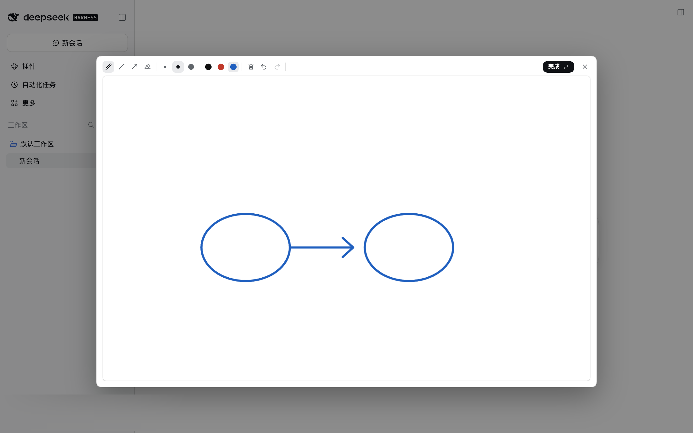
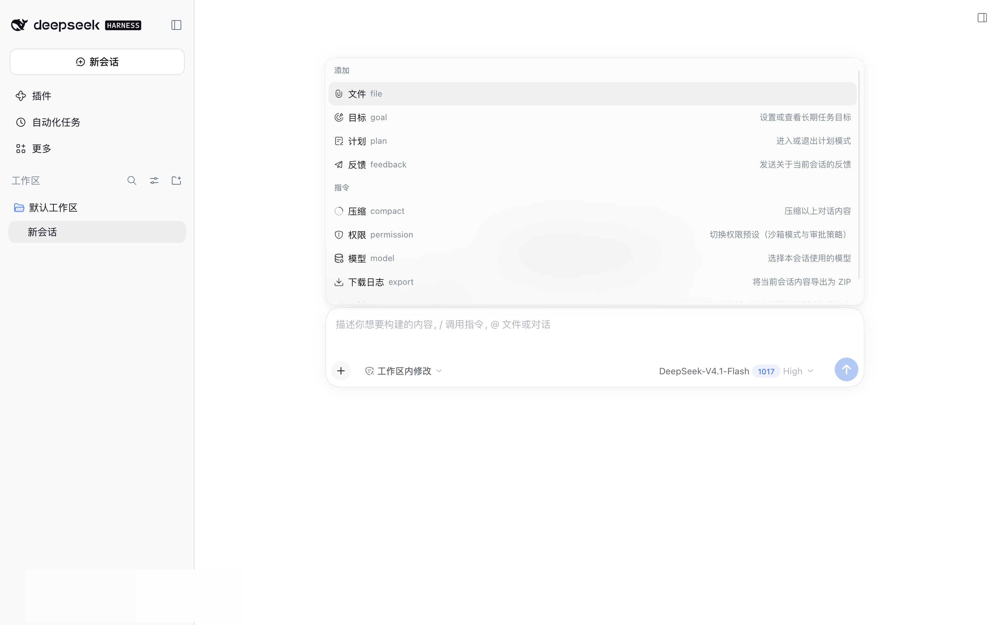
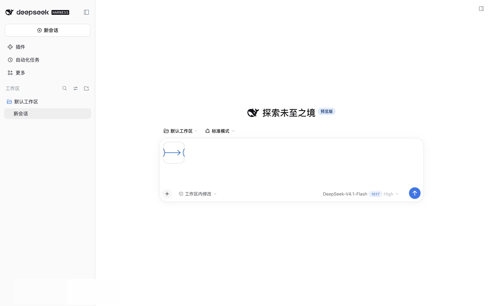
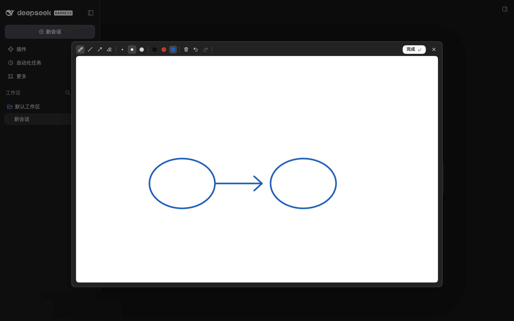

# dsh-sketchpad

English | [中文](README.zh.md)

A drawing board for [DeepSeek Harness](https://github.com/deepseek-ai/dsh). Handwrite a formula, sketch a diagram or jot a note, then attach the picture to your message.



## Features

- **Entry points** — the **Sketchpad** row in the composer's `+` menu (also `/sketchpad`), and the right-sidebar tab.
- **Floating board** — 1600×1000 landscape. `Esc`, the `×`, a backdrop click or a double-click closes it;
  **closing only closes** — press **Done** to put the drawing in the message.
- **Sidebar board** — a portrait 1000×1333 right-sidebar tab with its own strokes and attachment.
- **Only explicit saves** — nothing is encoded while drawing; the PNG is made only when you press **Done**.
- **Cropped export** — cut to the ink bounding box plus 26 px; small sketches are upscaled up to 2.5× (about 900 px on the long side).
- **Tools** — pen, line, arrow, eraser with a round cursor; widths 4 / 7 / 12 px; black, red and blue; `Shift` snaps to 0°/45°/90°.
- **Undo, immediate clear, one pointer** — a second finger cannot join the current stroke.
- **Shortcuts** — `B` `L` `A` `E` tools, `1` `2` `3` colours, `[` `]` width, `Ctrl/Cmd+Z` undo, `Ctrl/Cmd+Shift+Z` redo, `Enter` done, `Esc` closes the floating board.
- **Chinese and English** — UI copy follows the host language (reads `<html lang>`).
- **A fresh canvas per open** — the previous sketch is not lost: it sits one **undo** away, and redo empties the board again.

## Install

DSH 0.2.1-rc.2 or newer.

```sh
dsh plugin --profile web add dsh-sketchpad
```

Restart `dsh web` (or refresh after a live install).

## Usage



1. Open **Sketchpad** from the composer's `+` menu (or `/sketchpad`, or the **drawing board** sidebar tab).
2. Draw.
3. Press **Done** (or hit Enter) to attach the drawing; closing with the `×` leaves the composer alone.
4. Send.

Floating **Done** freezes the drawing, clears the board and closes the window; the sidebar's **Done** keeps the tab open for the next one.





## Permissions and data

No network requests and no message access. The plugin uses the host's draft-attachment API, the session-scoped input state, the sidebar tab API, and `localStorage` for the pen colour and width only. Drawings stay in page memory; the PNG is created in the browser.

## Limits

No pressure or palm rejection. The two boards are independent, sizes are fixed, clear cannot be undone, and a page refresh clears the boards.

## Development

See [docs/DEVELOPMENT.md](docs/DEVELOPMENT.md). License: [MIT](LICENSE).
