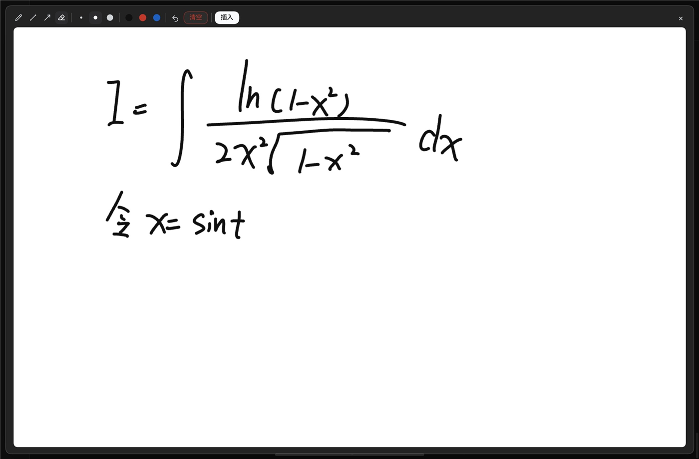
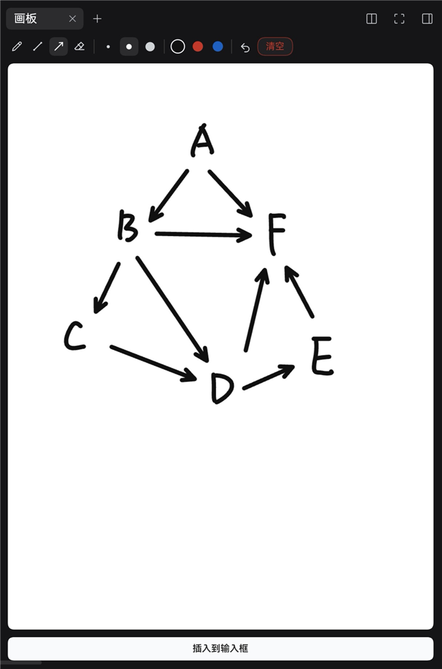
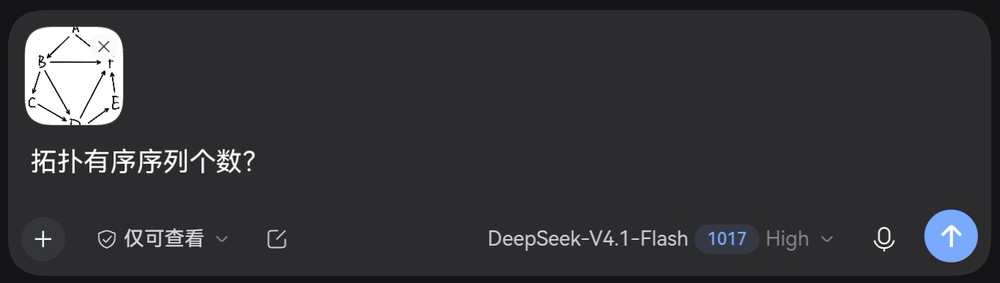

# dsh-sketchpad · DSH 画板

[English](README.md) | 中文

给 [DeepSeek Harness](https://github.com/deepseek-ai/dsh) 加一块画板：手写公式、画示意图或随手记，画完把图片作为附件发出去。



## 功能

- **入口**：输入框 `+` 菜单里的 **画板**（也可以 `/sketchpad`）、输入框左侧铅笔按钮、右侧栏画板标签页。
- **浮动画板**：横版 1600×1000。`Esc`、`×`、点遮罩、双击空白都能关闭；关闭只是关掉，画面要放进消息请点 **完成**。
- **全屏**：工具条上的按钮（或按 `F`）把浮窗铺满整个窗口，选择会记住，下次打开沿用。
- **侧栏画板**：右侧栏竖版 1000×1333，笔画与附件独立。
- **只在明确操作时生成图片**：绘制过程不编码；点「完成」时才导出 PNG。
- **导出裁切**：按笔画包围盒 + 26 px，小图最多放大 2.5 倍（长边约 900 px）。
- **工具**：水笔、直线、箭头、删除笔画（点一下或划过去整笔删掉）；笔宽 4 / 7 / 12 px；黑、红、蓝；`Shift` 吸附 0°/45°/90°。
- **撤销（40 步）、重做、双指轻点撤销**：`Ctrl/Cmd+Z`、`Ctrl/Cmd+Shift+Z`、工具条按钮，或在画板上双指轻点；清空和删除也能撤销。
- **中英文界面**：跟随宿主语言（`<html lang>`）自动切换。
- **触摸屏防误触**：笔按着时触摸不画；接触面明显大于本机手指（自动学习，下限 55 px）按手掌丢弃；触摸要拖出 5 px 才落墨。手掌压一下不留点，手指照样能画。
- **快捷键**：`B` `L` `A` `E`、`1` `2` `3`、`[` `]`、`Ctrl/Cmd+Z`、`Ctrl/Cmd+Shift+Z`、`F`、`Enter`、`Esc`。

## 安装

需要 DSH 0.2.1-rc.2 或更新版本。

```sh
dsh plugin --profile web add dsh-sketchpad
```

重启 `dsh web`（热安装后刷新页面也可以）。

## 使用

1. 从输入框 `+` 菜单打开 **画板**（或 `/sketchpad`、左侧铅笔按钮、右侧栏的 **画板**）。
2. 画。
3. 点 **完成** 把画面放进消息（关闭浮窗只是关掉）。
4. 发送。

浮窗的 **完成** 会冻结画面、清空画板并关闭窗口；侧栏的 **完成** 保留标签页，方便接着画下一张。





## 权限与数据

不发网络请求，也不读取消息内容。只使用宿主的草稿附件 API、会话输入状态、右侧栏 API，以及 `localStorage` 记笔色和粗细。画板只在页面内存里，PNG 在浏览器里生成。

## 限制

没有压感；掌托识别是启发式的（笔优先、按本机手指尺寸自适应、拖动阈值），手掌如果报出的接触面和手指差不多，仍可能漏进来。两块画板内容独立；尺寸固定；刷新页面会清空画板。

## 开发

见 [docs/DEVELOPMENT.md](docs/DEVELOPMENT.md)。许可证：[MIT](LICENSE)。
